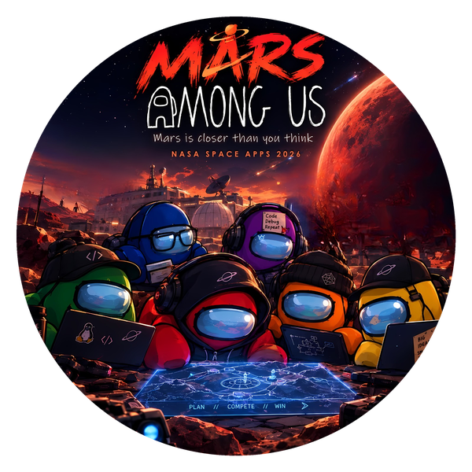
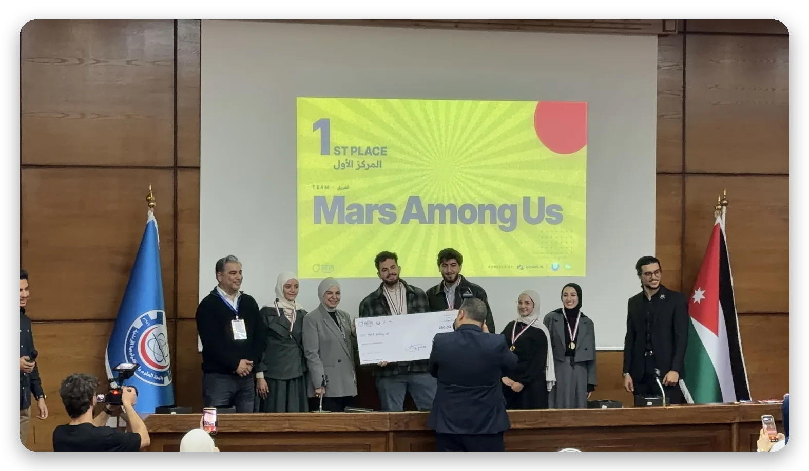
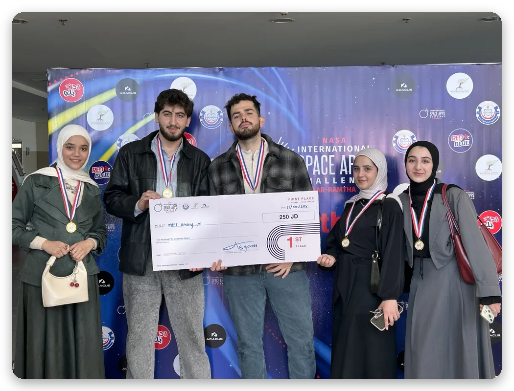
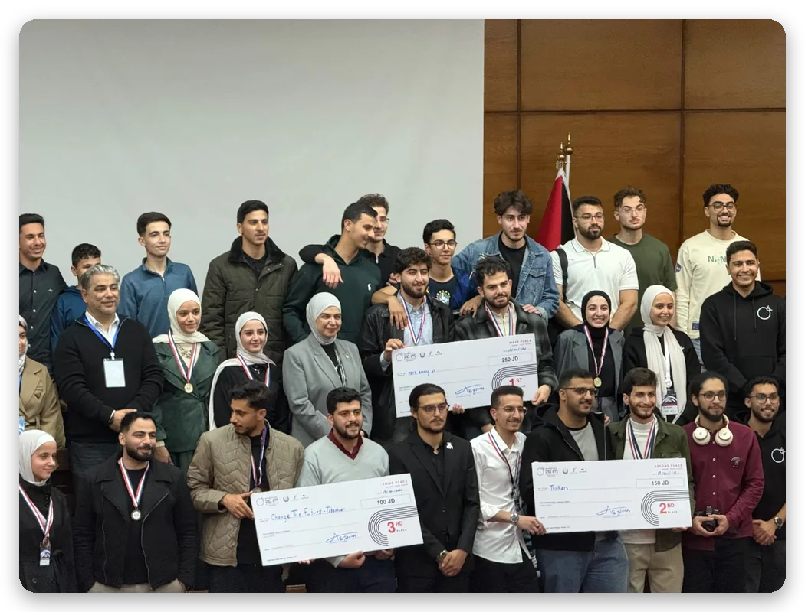

<p align="center">
  
</p>

<p align="center">
  
</p>

<h1 align="center">Mars Among Us</h1>

<p align="center">
  
</p>

<p align="center"><b>Find the places on Earth that resemble the Moon and Mars, and see why.</b></p>

<p align="center">
  
  
  <a href="https://malkawi06.github.io/MarsAmoungUs/"></a>
</p>

<p align="center">
  <a href="#first-place">🏆 First place</a> &nbsp;·&nbsp;
  <a href="#the-site">🧭 The site</a> &nbsp;·&nbsp;
  <a href="#how-it-works">⚙️ How it works</a> &nbsp;·&nbsp;
  <a href="#run-locally">💻 Run locally</a> &nbsp;·&nbsp;
  <a href="#data-and-credits">📚 Data and credits</a>
</p>

> [!TIP]
> **Try it live:** [malkawi06.github.io/MarsAmoungUs](https://malkawi06.github.io/MarsAmoungUs/) runs in your browser, nothing to install.

<p align="center">
  
</p>

## First place

<p align="center"><b>🏆 NASA Space Apps Challenge 2026 &nbsp;·&nbsp; Ar-Ramtha, Jordan &nbsp;·&nbsp; 17 November 2026</b></p>

<p align="center">
  <i>We are proud of what we built together: a tool that searches all of Earth's land<br>
  for places like the Moon and Mars, and shows the evidence behind every number.</i>
</p>

<p align="center">
  
</p>

<table>
  <tr>
    <td align="center" width="50%">
      <br>
      <b>The team</b><br><sub>With the first-place cheque</sub>
    </td>
    <td align="center" width="50%">
      <br>
      <b>The winners</b><br><sub>With the Ar-Ramtha winners and organizers</sub>
    </td>
  </tr>
</table>

<div align="center">

| Place | Team              | Project       |
| :---: | :---------------- | :------------ |
|  🥇   | **Mars Among Us** | Mars Among Us |
|  🥈   | Thinkers          | SOL 200       |
|  🥉   | Change The Future | Tabasheer     |

</div>

<p align="center">
  
</p>

## The site

| Page                           | What it does                                                                                                                                                                                                                                                                                                                                                                                                  |
| ------------------------------ | ------------------------------------------------------------------------------------------------------------------------------------------------------------------------------------------------------------------------------------------------------------------------------------------------------------------------------------------------------------------------------------------------------------- |
| **Discover** (`/discover`)     | Pick a known Moon or Mars analog site; every 0.5° land cell on Earth is compared with it on the same NASA POWER climate, terrain and rock-type data, and the closest regions, including ones not yet studied as analogs, are shown on a map, with desert, cold and ESA permafrost filters and NASA terrain relief inside a selected patch. Built by `scripts/build_discover.py`.                              |
| **Closest to Mars** (`/mars`)  | All ice-free land ranked against Mars itself: colder, bigger day–night swing, drier and higher (thinner air) than how much of Earth's land, averaged. Mars values from NASA's Mars Fact Sheet. Never given a list of analogs, it puts NASA's Licancabur, ISRO's Tso Kar and the Qaidam Basin in the top 1% (`tests/marsIndex.test.ts`). Mars only: Moon analogs are chosen by rock and landform, not climate. |
| **Compare** (`/compare`)       | Pick a place on the Moon (the nine Artemis landing regions) or Mars and a purpose (rover testing, base, permanent Moon base, local resources, search for life, training). Every Earth site is scored factor by factor, with the target's orbital image next to the site and, for the Moon, what NASA's LRO measured there.                                                                                    |
| **Earth Analogs** (`/analogs`) | The analog sites on a satellite map, filtered by landform, each with the published research behind it.                                                                                                                                                                                                                                                                                                        |
| **About** (`/about`)           | The challenge, the solution, the data used and the team: the sections of the Space Apps submission form.                                                                                                                                                                                                                                                                                                      |

<p align="center">
  
  
  
  
  
  
  
</p>

<p align="center">
  
</p>

## How it works

### Orbital images (at deploy time)

The deploy workflow runs `scripts/fetch_earth_images.py`, which downloads ~6 km images of every site at
the same scale, so the Compare page can show a target and an Earth site side by side:

- Earth: EOxCloudless 2016 (EOX, Copernicus Sentinel-2).
- Mars: Global CTX Mosaic (Murray Lab).
- Moon: LROC NAC south-pole mosaic (Moon Trek), which covers 85.5°S to the pole (4 of the 9 Artemis regions), and the
  LROC NAC Artemis site mosaics for the other 5 (`scripts/lroc_roi.py`, needs rasterio and pyproj).

These files are built on every deploy and are not committed.

### Compare scoring

Each purpose compares its own factors (slope, rock type, landform, temperature, day–night swing, aridity,
ice, and for a permanent Moon base frozen ground and ground ice). Every factor scores 1, 2 or 3 with equal weights, after the NASA-led analog framework of Stern et al.
2025 (JGR Planets, doi 10.1029/2024JE008803). Factors with no sourced value are left out, and a score based
on fewer than two factors is flagged as low confidence.

- **Ties.** Three scores give few possible percentages, so sites often share one. Sites with the same
  percentage are ordered by how close their measured values are to the target's, and sites the data cannot
  tell apart share a place (shown as `=2`) instead of being listed in an arbitrary order.
- **Not compared yet.** Local relief, sunlight and radiation have no sourced, comparable value for any
  target, so they are not scored. The page names them under each purpose instead of counting them as factors.
- **Permanent Moon base.** For the challenge's polar base sites, Earth sites are scored on frozen ground
  (MODIS ground temperature: below 0 °C all year, or on average) and ground ice (ice in the site's sources, or
  ESA Permafrost_cci continuous / discontinuous permafrost), plus slope, rock and landform. Every Artemis region is
  colder than any of our Earth sites (Diviner), so cold is scored as frozen or not. Near-constant sunlight,
  vacuum and radiation have no Earth match and are named, not scored. `scripts/build_ground_temperature.py`
  reads the MODIS values from NASA GIBS into `analysis/data/ground_temp.csv`.
- **Landform.** Rover testing, base / habitat and the permanent Moon base also compare the kind of ground
  (massif, crater rim, plain), which is what sets the Artemis regions apart. A site with no recorded landform
  is left out of that factor, not scored as a mismatch.
- **Mars slope.** Jezero, Gale, Victoria and Arcadia have no published slope limit, so
  `scripts/build_mars_slope.py` measures one from MGS MOLA topography (128 pixels/degree): 90% of the ground
  within 10 km is flatter than it. Oxia Planum keeps its published 8° (MOLA gives 1.0° there).
- **Slope limits.** The 8° Artemis landing limit is a Moon rule: it gives Moon targets a partial score and
  the base / habitat landing rule. A Mars target is compared with its own published slope only.

The data and its sources are in [`analysis/`](analysis/README.md); regenerate `src/data/compare.ts` with
`python3 analysis/build_compare_data.py`.

### Moon environment

`scripts/build_moon_environment.py` measures each Artemis region from NASA Lunar Reconnaissance Orbiter data,
within 7.5 km of its centre: sunlight and permanent shadow from LOLA, surface temperature and stable ice from
Diviner, and the radar circular polarization ratio (CPR) from the Mini-RF global mosaic. CPR above 1 is what
ice gives, and rough ground too, so it is shown as a measurement, not as ice. It downloads only the parts of each file around the regions and writes
`analysis/data/moon_environment.json`, which `analysis/build_compare_data.py` adds to the Moon targets.
Temperature and ice set the Moon side of the Permanent Moon base factors; sunlight and radar are shown only.

### Closest to Mars

`src/lib/marsIndex.ts` ranks every ice-free Discover cell on four conditions where Mars is more
extreme than anywhere on Earth: mean temperature (lower), day–night swing (larger), precipitation
(lower) and elevation (higher, so thinner air). Each condition becomes a percentile, the share of
ice-free land the cell is more Mars-like than, and the index is their mean (0–100). It ranks how far
a place goes toward Mars, not how close it gets. `tests/marsIndex.test.ts` checks the page's claims:
the top region is on the Tibetan Plateau, also with the weights changed at random 40 times; the
analog sites in `site.mars.checks` rank in the top 1%; known Mars analogs rank far above random land
and known Moon analogs do not.

### Discover grid

`scripts/build_discover.py` builds `public/discover/cells.json`: every 0.5° land cell with NASA POWER
climate, mean elevation and relief from terrain tiles, and the dominant GLiM rock class. It needs numpy, Pillow and
xarray with zarr support, and is run by hand; the result is committed. `scripts/build_permafrost.py` then adds
`permafrostPct` from ESA Permafrost_cci (Northern Hemisphere, 2019), which the permafrost filter uses; run it
again after `build_discover.py`.

The maps also offer NASA's monthly MODIS land surface temperature (GIBS, the imagery behind Worldview), the
temperature of the ground itself, like Diviner's on the Moon. Every Earth site links to NASA Worldview and
Earthdata Search. Selecting a Discover region fits its 50 km patch on the map, outlined, with NASA's ASTER GDEM
shaded relief (via GIBS) over the satellite image, so the terrain inside the patch shows at about 30 m. The
patch itself stays 0.5° because NASA POWER climate is no finer.

**Check against known analogs.** From each known analog site, the closest other known site (at least 400 km
away, found by other researchers) ranks in about the top 1% of Earth's land; places picked at random would
rank in about the top 3%. The numbers are worked out from the data on every build
(`checkAgainstKnown` in `src/lib/discover.ts`) and shown on Home and Discover; a test fails if the method
stops beating chance by at least two times.

**New twins on Home.** The same search, run from four known sites (`site.home.discovery` and
`moreDiscoveries`), names the best region on no list we know. The names are written by hand, so the build
stops if the data moves a result more than 100 km. Discover matches environment, not landform shape. Two regions are confirmed by published work on a Moon or Mars process found there (pingos in northern Alaska, Jones et al. 2012; dust devil tracks in coastal Peru, Hesse 2012); the others are shown as leads.
`scripts/check_discover_robustness.ts` (run by hand) checks the method against stricter nulls
(climate alone ranks the other known sites in the top 1.6%, terrain and rock alone 1.8%, all seven
traits 0.8%) and counts how often each Home region holds when every tolerance is changed at random by up
to ±50% (`holds` in `site.home`). Craters and the Antarctic valleys match poorly: landform is not in the grid.

Discover and Compare measure terrain at different scales, and each page labels its own. Compare measures a
0.6 km window at the site on the 30 m ASTER model; Discover averages a patch about 50 km across at about
1 km. The same place therefore has different elevation and relief on the two pages. Slope is not in the
Discover grid, because it means nothing at that scale.

<p align="center">
  
</p>

## Run locally

Requires **Node.js 20.19+ or 22.12+**.

```bash
git clone https://github.com/malkawi06/MarsAmoungUs.git
cd MarsAmoungUs
npm install
npm run dev              # http://localhost:5173
```

The orbital images are downloaded at deploy time. To have them locally (needs Python 3 with Pillow):

```bash
python scripts/fetch_earth_images.py
```

| Script                 | What it does                               |
| ---------------------- | ------------------------------------------ |
| `npm run dev`          | Dev server with hot reload                 |
| `npm run build`        | Type-check (`tsc -b`) and production build |
| `npm run preview`      | Serve the production build locally         |
| `npm run lint`         | ESLint                                     |
| `npm test`             | Unit tests (Node's built-in test runner)   |
| `npm run format`       | Format everything with Prettier            |
| `npm run format:check` | Check formatting without writing           |

## Deploy

GitHub Pages is the main host: `.github/workflows/deploy-pages.yml` fetches the images, builds
and publishes every push to `main`. Each page also gets its own copy of `index.html` (`discover/`, `compare/`,
`analogs/`, `about/`), so a direct link answers 200 instead of GitHub Pages' 404 fallback. `netlify.toml` and `vercel.json` keep the same app working on Netlify
and Vercel (SPA fallback), without the satellite images.

## Project layout

```
src/
├── config/site.ts       ← all page text: name, pitch, nav, About sections, team, links
├── data/
│   ├── analogs.ts       ← Earth analog sites per landform, with sources
│   ├── compare.ts       ← generated by analysis/build_compare_data.py
│   └── glossary.ts      ← what each rock and landform word means, with sources
├── lib/
│   ├── discover.ts      ← Discover: grid lookup, trait similarity, filters, top regions
│   ├── similarity.ts    ← Compare: factor scores, match percentage, ranking and ties
│   └── orbitalImages.ts ← reads the deploy-time orbital images
├── components/          ← shared UI (PageHeader, Photo, TargetImages, AnalogMap, DiscoverMap, …)
├── pages/               ← Home, Discover, Compare, Analogs, About
└── index.css            ← Tailwind, light/dark color tokens, scroll and photo animations
public/
├── discover/cells.json  ← the Discover grid, built by scripts/build_discover.py
└── photos/              ← NASA photos behind Home and the page headers (credits in site.ts)
analysis/                ← sourced data and method for Compare
scripts/
├── build_discover.py    ← builds the Discover grid (run by hand, result committed)
├── build_moon_environment.py ← LRO sunlight, temperature, ice and radar per Artemis region (run by hand)
├── build_permafrost.py  ← adds ESA permafrost to the Discover grid (run by hand, after build_discover.py)
├── build_countries.py   ← country of every Discover cell, from Natural Earth (run by hand)
├── build_ground_temperature.py ← MODIS ground temperature per Earth site (run by hand)
├── build_mars_slope.py  ← MOLA slope around the Mars targets (run by hand)
├── fetch_earth_images.py ← deploy-time orbital images
└── lroc_roi.py          ← LROC Artemis site mosaics, used by fetch_earth_images.py
tests/                   ← unit tests for both scoring modules and checks on the data files
```

## Data and credits

- **Mars landform classes (Earth Analogs filter):** DoMars16k, Wilhelm et al. 2020, doi 10.5281/zenodo.4291940.
- **Global CTX Mosaic of Mars:** NASA/JPL/MSSS/The Murray Lab.
- **LROC NAC south-pole mosaic:** NASA/GSFC/Arizona State University, via NASA Moon Trek.
- **LROC NAC Artemis site mosaics:** NASA/GSFC/Arizona State University; Henriksen et al. 2023, European Lunar Symposium.
- **Artemis candidate landing regions:** NASA, October 28, 2024 (announced for Artemis III; since February 2026 NASA plans the first crewed landing for Artemis IV). Region centres from JGR Planets 2025, doi 10.1029/2025JE009434.
- **Climate:** NASA POWER, 2001–2020.
- **Moon sunlight and shadow:** LRO LOLA average illumination maps (Mazarico et al. 2011, Icarus).
- **Moon temperature and stable ice:** LRO Diviner Polar Resource Product (Paige et al. 2010, Science).
- **Moon radar:** LRO Mini-RF global mosaic, CPR, 32 pixels/degree (PDS Geosciences Node); meaning of CPR after
  Spudis et al. 2013, JGR Planets.
- **Ground temperature:** MODIS Terra land surface temperature, monthly, via NASA GIBS/Worldview (map layer, and 2025
  values per Earth site). Frozen ground and permafrost definitions: NSIDC.
- **Permafrost (Discover):** ESA Permafrost_cci, permafrost extent v3.0 (2019), via the ESA Open Science Catalog
  and CEDA.
- **Elevation and slope (Compare):** ASTER GDEM (NASA/METI); its shaded relief via NASA GIBS on Discover.
- **Mars slope:** MGS MOLA MEGDR topography, 128 pixels/degree (PDS Geosciences Node).
- **Elevation and relief (Discover):** Terrain Tiles on AWS (SRTM and other elevation data).
- **Rock type (Discover):** GLiM Global Lithological Map, Hartmann & Moosdorf 2012 (CC BY 3.0).
- **Country names (Discover):** Natural Earth 1:50m countries (public domain), in the TopoJSON of world-atlas 2.0.2;
  `scripts/build_countries.py` writes `public/discover/countries.json`.
- **Earth satellite images and map:** EOxCloudless 2016 by EOX IT Services GmbH (contains modified Copernicus Sentinel data 2016 & 2017), CC BY 4.0.
- **Street map:** © OpenStreetMap contributors, ODbL.
- **Page photos:** NASA Image and Video Library: Curiosity (PIA23898, NASA/JPL-Caltech/MSSS), Perseverance
  (PIA23727, NASA/JPL-Caltech/ASU/MSSS), Apollo 15 (jsc2011e118359, NASA) and the Haughton-Mars Project
  (ARC-2007-ACD07-0170-005 and -006, NASA). Each page links its photo's NASA page.

### Licences

Space Apps asks that non-NASA material be freely usable or open source, with its licence listed.

| Material                                              | Licence                                                 |
| ----------------------------------------------------- | ------------------------------------------------------- |
| NASA data and images (POWER, LRO, NASA Image Library) | No copyright in the US (NASA media and data guidelines) |
| Global CTX Mosaic of Mars (The Murray Lab)            | Free use for all purposes, with credit                  |
| EOxCloudless 2016 (EOX, Copernicus Sentinel-2)        | CC BY 4.0                                               |
| OpenStreetMap                                         | ODbL 1.0                                                |
| ESA Permafrost_cci                                    | Any use, with credit to ESA CCI and Permafrost_cci      |
| GLiM lithological map                                 | CC BY 3.0                                               |
| React, React DOM, React Router                        | MIT                                                     |
| Leaflet                                               | BSD-2-Clause                                            |
| Lucide icons                                          | ISC                                                     |
| Barlow, Barlow Condensed fonts                        | OFL-1.1                                                 |

This project is not affiliated with or endorsed by NASA.

<p align="center">
  
</p>

<p align="center">
  
</p>

<h3 align="center">Mars Among Us</h3>

<p align="center"><sub>🥇 &nbsp;FIRST PLACE &nbsp;·&nbsp; NASA SPACE APPS CHALLENGE 2026 &nbsp;·&nbsp; AR-RAMTHA, JORDAN</sub></p>

<table align="center">
  <tr>
    <td align="center" width="33%"><a href="https://www.linkedin.com/in/mohammad-h-malkawi/"><b>Mohammad Huseen Malkawi</b></a><br><sub>Creator · Data, web and submission</sub></td>
    <td align="center" width="33%"><a href="https://www.linkedin.com/in/nour-oqaily-4310b6440/"><b>Nour Oqaily</b></a><br><sub>Website testing</sub></td>
    <td align="center" width="33%"><a href="https://www.linkedin.com/in/mohammad-kilani-413317366/"><b>Mohammad Kilany</b></a><br><sub>Presentation</sub></td>
  </tr>
  <tr>
    <td align="center" width="33%"><a href="https://www.linkedin.com/in/aisha-mohammad-202907416/"><b>Aisha</b></a><br><sub>Source review</sub></td>
    <td align="center" width="33%"><a href="https://www.linkedin.com/in/hadeel-abughazleh-89aa0a32b/"><b>Hadeel Abughazleh</b></a><br><sub>Research and ideas</sub></td>
    <td align="center" width="33%"><a href="https://www.linkedin.com/in/hadeel-qamar-779241311/"><b>Hadeel Qamar</b></a><br><sub>Research and ideas</sub></td>
  </tr>
</table>

<p align="center">
  <a href="https://malkawi06.github.io/MarsAmoungUs/">🌐 Live site</a> &nbsp;·&nbsp;
  <a href="https://malkawi06.github.io/MarsAmoungUs/mars">🔴 Closest to Mars</a> &nbsp;·&nbsp;
  <a href="#top">⬆️ Back to top</a>
</p>

<p align="center">
   &nbsp;<b>Made with ❤️ in Jordan 🇯🇴</b>&nbsp; 
</p>

<p align="center">
  
</p>
